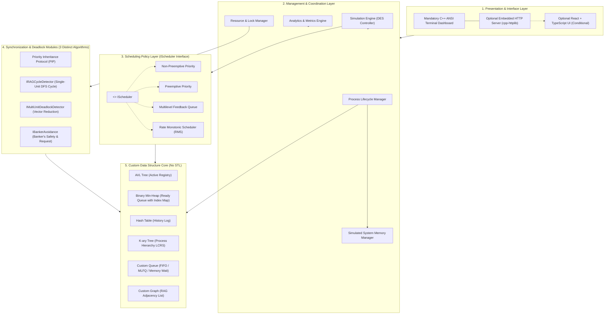
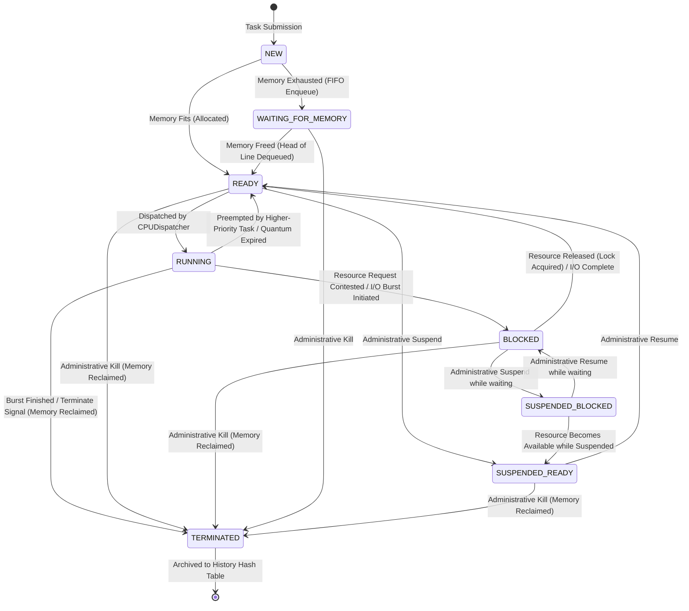
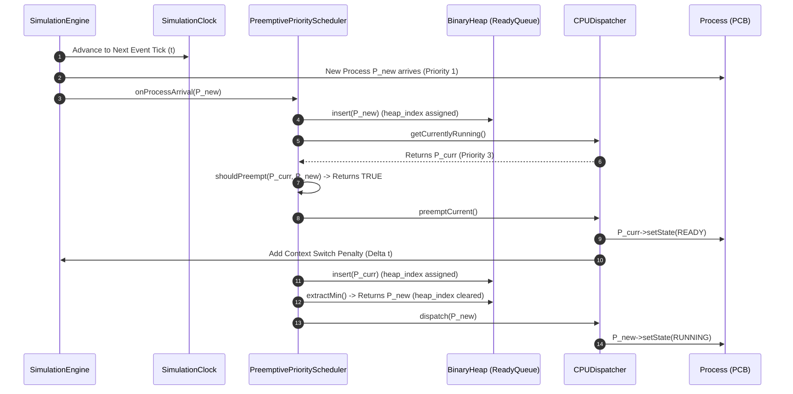
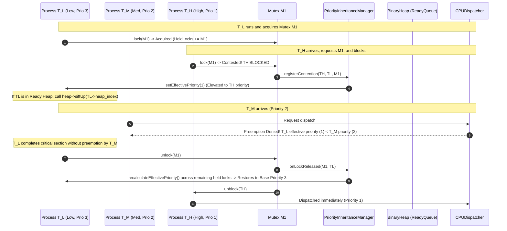
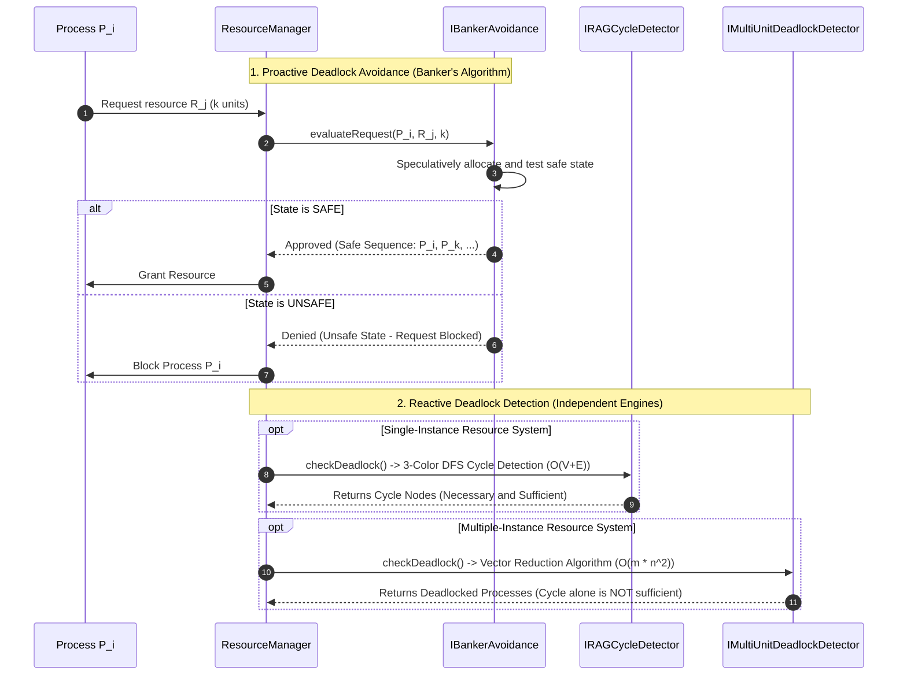

# System Architecture: OS-Level Task Priority Scheduler

**Document ID:** `DOC-ARCH-001`  
**Phase:** Phase 0 (Requirements Analysis and Implementation Planning)  
**Status:** READY FOR TEAM APPROVAL  
**Authors:** Minarv Tyagi, Akshat Verma, Keshav Kishor  
**Institution:** Jaypee Institute of Information Technology (JIIT)  
**Supervisors:** Dr. Varun Srivastava, Dr. Kirti Jain  

---

## 1. Architectural Principles and Design Philosophy

The architecture of the **OS-Level Task Priority Scheduler** adheres to foundational principles of systems programming and software engineering:

1. **Separation of Concerns:** Algorithmic scheduling decisions are strictly decoupled from discrete-event time management, CPU execution simulation, simulated physical memory tracking, and user presentation.
2. **Open/Closed Principle for Schedulers:** New scheduling policies (e.g., MLFQ, RMS) can be added by implementing the `IScheduler` interface without modifying the simulation engine core or CPU dispatcher.
3. **Deterministic Simulation:** The engine uses discrete virtual time ticks. Given the same input workload and random seed, the simulator produces bit-for-bit identical scheduling decisions, metrics, and logs across runs.
4. **Single Source of Truth for Process State:** The `ProcessControlBlock` (`PCB`) encapsulates all metadata for a process (including memory footprint and heap index). Data structures store pointers to this central PCB rather than duplicating process data.
5. **No Kernel Dependency:** The engine runs entirely in user-space as an algorithmic simulator. It simulates preemption, context switching, memory admission, and interrupts mathematically without invoking host OS threading or kernel signals.

---

## 2. High-Level System Architecture

The system is organized into five modular layers:



---

## 3. Modular Decomposition and Responsibilities

The system is composed of 17 distinct functional modules:

| Module # | Module Name | Responsibilities | Key Collaborators |
|:---:|:---|:---|:---|
| **1** | `ProcessModel` | Defines `PCB`, execution attributes, memory footprint, base/effective priority, timestamps, `heap_index`, and state flags. | All modules |
| **2** | `SimulationClock` | Advances virtual discrete time (ticks $\Delta t=1$ or event jumps); coordinates event arrival sequencing. | `SimulationEngine` |
| **3** | `MemoryManager` | Simulates system physical RAM capacity (e.g., 1024 MB); enforces admission control on `NEW` tasks; queues memory-exhausted tasks in a strict `CustomFIFOQueue`. Explicitly documents and reports **Head-of-Line (HoL) blocking**; reclaims memory on termination. | `ProcessManager`, `SimulationEngine` |
| **4** | `CPUDispatcher` | Simulates execution of the active process on the CPU; accounts for context-switch latency penalties; decrements remaining burst time. | `SimulationEngine`, `ProcessModel` |
| **5** | `IScheduler` | Abstract pure virtual interface defining the contract between the engine and any scheduling algorithm. | `SimulationEngine`, Schedulers |
| **6** | `PriorityScheduler` | Implements Non-Preemptive and Preemptive Priority policies; evaluates heap root on process arrival with deterministic tie-breaking. | `IScheduler`, `BinaryHeap` |
| **7** | `MLFQScheduler` | Implements multi-tier queue management, quantum consumption, demotion, voluntary I/O yield preservation, and periodic priority boost. | `IScheduler`, `CustomQueue` |
| **8** | `SingleUnitRAGDetector` | Implements `IRAGCycleDetector`: maintains RAG and executes 3-color DFS cycle detection ($O(V+E)$) on single-instance resource graphs. | `CustomGraph`, `ResourceManager` |
| **9** | `VectorReductionDetector` | Implements `IMultiUnitDeadlockDetector`: executes Vector Reduction Algorithm (Shoshani-Coffman) maintaining `Available`, `Allocation`, and `Request` matrices ($O(m \times n^2)$). | `ResourceManager` |
| **10** | `BankerAvoidance` | Implements `IBankerAvoidance`: evaluates prospective requests, runs Dijkstra's safety algorithm, and generates safe execution sequences proactively. | `ResourceManager` |
| **11** | `ResourceManager` | Tracks resource instances, ownership, allocation vectors, and blocked wait-queues. | Deadlock modules |
| **12** | `PriorityInheritance` | Implements PIP: supports multiple independent mutexes, multiple waiting tasks, multiple held locks per process, dynamic priority elevation, and effective priority recalculation upon lock release. (Nested/transitive chains deferred to extension). | `ProcessModel`, `PriorityScheduler` |
| **13** | `RMSScheduler` | Implements Rate Monotonic real-time scheduling: static priority assigned by rate-monotonic rule ($T_i < T_j \implies \text{Priority}_i < \text{Priority}_j$, where smaller numerical value = higher priority under project convention); documents the 7 Liu-Layland assumptions and $U \le 1$ feasibility condition; supports configurable simulation horizon ($H_{sim}$), hyperperiod overflow handling, and deterministic boundary completion ordering. | `IScheduler`, `ProcessModel` |
| **14** | `CustomDataStructures` | Provides native C++ implementations of AVL Tree, Binary Heap, Hash Table, K-ary Tree, FIFO Queue, and Graph. | All management modules |
| **15** | `MetricsEngine` | Computes average/per-process waiting time, turnaround time, response time, CPU utilization, throughput, and starvation telemetry. | `SimulationEngine`, `HashTable` |
| **16** | `WorkloadLoader` | Validates and ingests synthetic workload files (JSON/CSV); verifies input parameters (non-negative bursts, valid priorities, memory weights). | `ProcessManager`, `SimulationEngine` |
| **17** | `InterfaceAdapter` | Exposes simulation controls via **Mandatory ANSI Terminal CLI** (default) or **Optional Embedded HTTP Server** (conditional on team approval). | External clients |

---

## 4. Decoupling Engine and Scheduling Policies (`IScheduler`)

To prevent the anti-pattern of a monolithic scheduling function packed with complex `if/else` or `switch` statements, all policies implement the `IScheduler` interface:

```cpp
// Conceptual interface definition (C++17)
class IScheduler {
public:
    virtual ~IScheduler() = default;
    
    // Lifecycle hooks called by the SimulationEngine
    virtual void onProcessArrival(Process* process) = 0;
    virtual Process* selectNextProcess() = 0;
    virtual bool shouldPreempt(const Process* currentRunning, const Process* newlyArrived) const = 0;
    virtual void onTick(uint64_t currentTick) = 0;
    virtual void onProcessYield(Process* process) = 0;
    virtual void onProcessBlock(Process* process) = 0;
    virtual void onProcessTerminate(Process* process) = 0;
    
    // Informational query for state serialization
    virtual const char* getPolicyName() const = 0;
};
```

---

## 5. Process State Model and Lifecycle Transitions

### 5.1. Process States
- **`NEW`:** Process is parsed from workload or generated, but not yet evaluated for memory admission.
- **`WAITING_FOR_MEMORY`:** Process is queued in the strict FIFO admission queue awaiting sufficient free system memory capacity.
- **`READY`:** Process resides in the scheduler's ready queue (Heap, MLFQ queue, or RMS release table) awaiting CPU execution.
- **`RUNNING`:** Process currently occupies the simulated CPU. (At most 1 process per CPU core).
- **`BLOCKED`:** Process is waiting for an unavailable resource (mutex lock) or simulated I/O completion.
- **`SUSPENDED_READY`:** Process is active but swapped out of active scheduling by admin/user intervention.
- **`SUSPENDED_BLOCKED`:** Process is blocked on a resource and simultaneously suspended.
- **`TERMINATED`:** Process has completed execution or was killed; archived in the historical Hash Table.

### 5.2. State Transition Diagram



### 5.3. Legal State Transition Matrix and Structural Invariants

| From State | To State | Trigger Event | Structural Invariant & Synchronization Action |
|:---|:---|:---|:---|
| `NEW` | `READY` | Memory Fit & Admission | Allocate memory footprint in `MemoryManager`; insert into AVL Registry; insert into Scheduler Ready Queue; insert into K-ary Tree. |
| `NEW` | `WAITING_FOR_MEMORY` | Memory Exhaustion | Insert into FIFO memory admission queue; process does not enter AVL tree or scheduler. |
| `WAITING_FOR_MEMORY` | `READY` | Memory Reclaimed | When memory freed and task is at head of FIFO, allocate memory, dequeue, insert into AVL and Scheduler Ready Queue. |
| `READY` | `RUNNING` | Dispatch | Extract from Ready Queue (`p->heap_index = INDEX_NONE`); set as CPU active task; log context switch. |
| `RUNNING` | `READY` | Preemption | Re-insert into Ready Queue (`p->heap_index` updated); record preemption event. |
| `RUNNING` | `BLOCKED` | Contention / I/O | Remove from CPU; attach to Resource Wait-Queue; update RAG request edge. |
| `BLOCKED` | `READY` | Unblock | Remove from Resource Wait-Queue; insert into Ready Queue; update RAG assignment edge. |
| `READY` | `SUSPENDED_READY` | Suspend | Remove from Ready Queue; retain in AVL Tree with `SUSPENDED_READY` flag. |
| `SUSPENDED_READY` | `READY` | Resume | Re-insert into Ready Queue. |
| `ANY_ACTIVE` | `TERMINATED` | Completion / Kill | Remove from CPU/Queue/Wait-Queue; deallocate memory footprint in `MemoryManager`; remove from AVL Tree; insert record into History Hash Table; handle child orphan re-parenting in K-ary Tree. |

---

## 6. Detailed Data Flow for Key Workflows

### 6.1. Workflow 1: Preemptive Priority Scheduling Arrival


### 6.2. Workflow 2: Priority Inversion and Priority Inheritance Protocol


### 6.3. Workflow 3: Deadlock Management (Three Distinct Algorithms)


---

## 7. Frontend / Backend Architecture Evaluation

1. **Mandatory Core (Option A):** The **C++ ANSI Terminal Dashboard** is the primary, required presentation layer. It requires zero external dependencies, compiles instantly with CMake, and provides interactive text-based execution, tabular process dumps, and ASCII Gantt logs.
2. **Optional Web UI (Option B):** The embedded C++ HTTP server (`cpp-httplib`) and React web UI are strictly an optional extension. **The embedded HTTP server will only be implemented if the team explicitly approves the React frontend.** The simulator core will never depend on the web interface for any evaluation or execution capability.

---

## 8. Module Dependencies and Recommended Implementation Order

```
[Phase 1] CMake Toolchain & Custom Test Harness
    │
    ▼
[Milestone 1.5] SHARED INTERFACE FORMAL SIGN-OFF GATE (Process, IScheduler, Clock, Resource, Memory)
    │
    ▼
[Phase 2] Process Model & Custom Data Structures (AVL, Heap, Hash, K-ary, Queue, Graph)
    │
    ▼
[Checkpoint] PROGRESS & BURN RATE REVIEW (Assess actual hours vs 255-hour preliminary target)
    │
    ▼
[Phase 3] Core Simulation Engine, Clock, CPU Dispatcher & Memory Admission Controller
    │
    ├──────────────────────────┬──────────────────────────┐
    ▼                          ▼                          ▼
[Phase 4] Priority Schedulers  [Phase 6] Deadlock Modules  [Phase 5] MLFQ Scheduler
    │                          (Single RAG, Multi Reduc,  (Custom Queues + Boost)
    │                           Banker's Avoidance)       │
    ├──────────────────────────┴──────────────────────────┘
    ▼
[Phase 7] Priority Inversion & Multi-Lock PIP Protocol (Nested chains deferred)
    │
    ▼
[Phase 8] Rate Monotonic Real-Time Scheduler (RMS) (Sufficiency, Horizon, Event Ordering)
    │
    ▼
[Phase 9A] MANDATORY C++ ANSI Terminal CLI Dashboard (Tabular Metrics + ASCII Gantt)
    │
    ├ - - - [Phase 9B Optional React Web UI & Embedded HTTP Server]
    ▼
[Phase 10] Full System Verification (Sanitizers, Benchmarks, Stress)
    │
    ▼
[Phase 11] Documentation & Defense Rehearsal
```
