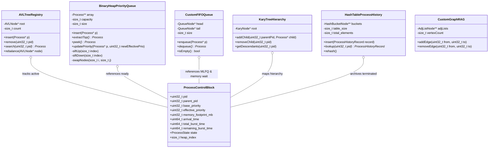

# Custom Data Structures Specification: OS-Level Task Priority Scheduler

**Document ID:** `DOC-DS-001`  
**Phase:** Phase 0 (Requirements Analysis and Implementation Planning)  
**Status:** READY FOR TEAM APPROVAL  
**Authors:** Minarv Tyagi, Akshat Verma, Keshav Kishor  
**Institution:** Jaypee Institute of Information Technology (JIIT)  
**Supervisors:** Dr. Varun Srivastava, Dr. Kirti Jain  

---

## 1. Scope of the Standard Template Library (STL) Restriction

A critical constraint stated in the project synopsis is:
> *"Core Logic: C++ (Standard Template Library bypassed in favour of custom node structures for the core scheduling logic)."*

### Clarification of Architectural Boundary:
To ensure compliance with academic evaluation standards while preserving maintainable, modern C++ architecture, the boundary of the STL restriction is formally specified as:
1. **Strictly Prohibited:** No STL container (`std::vector`, `std::map`, `std::set`, `std::list`, `std::deque`, `std::queue`, `std::priority_queue`, `std::unordered_map`) may be used to implement the active process registry, priority execution queue, process history log, process hierarchy, MLFQ ready queues, memory admission wait queues, or Resource Allocation Graph. All such structures must be written from scratch using custom node structures and explicit pointer management.
2. **Design Decision Requiring Team Confirmation (ADR-02):** Non-algorithmic utilities—specifically `std::string` for text parsing, `std::ostream` / `std::cout` for console printing, and standard file streams (`std::ifstream`) for workload loading—are permitted to prevent wasting dozens of hours writing boilerplate string and I/O routines.

---

## 2. Comprehensive Data Structure Catalog

The system requires six custom-built data structures:



---

## 3. Data Structure 1: AVL Tree (Active Process Registry)

### 3.1. Responsibility and Invariants
- **Primary Responsibility:** Serves as the authoritative registry of all currently admitted active processes in the system (`READY`, `RUNNING`, `BLOCKED`, `SUSPENDED`).
- **Key Invariant:** Binary Search Tree ordering on unique `PID`:
  $$\forall \text{ node } N, \quad \text{key}(N.\text{left}) < \text{key}(N) < \text{key}(N.\text{right})$$
- **Balance Invariant:** For every node $N$, the Balance Factor $BF(N) = \text{height}(N.\text{left}) - \text{height}(N.\text{right}) \in \{-1, 0, 1\}$.
- **Guaranteed Complexity:** Search, Insertion, and Deletion are strictly $O(\log n)$ worst-case.

### 3.2. Node Definition and Memory Footprint
```cpp
struct AVLNode {
    uint32_t pid;           // Search key
    Process* pcb_ptr;       // Non-owning pointer to central PCB
    int height;             // Subtree height for balance factor calculation
    AVLNode* left;          // Left subtree pointer
    AVLNode* right;         // Right subtree pointer
};
```
- **Memory Overhead:** $4 + 8 + 4 + 8 + 8 = 32$ bytes per registered process (on 64-bit architectures).

### 3.3. Balancing Operations
The AVL tree restores the balance invariant after insertions and deletions via four deterministic rotation primitives:
1. **Left-Left (LL) Heavy ($BF > 1$ and $BF(\text{left}) \ge 0$):** Single Right Rotation at node $Z$.
2. **Right-Right (RR) Heavy ($BF < -1$ and $BF(\text{right}) \le 0$):** Single Left Rotation at node $Z$.
3. **Left-Right (LR) Heavy ($BF > 1$ and $BF(\text{left}) < 0$):** Left Rotation on $Z.\text{left}$, followed by Right Rotation on $Z$.
4. **Right-Left (RL) Heavy ($BF < -1$ and $BF(\text{right}) > 0$):** Right Rotation on $Z.\text{right}$, followed by Left Rotation on $Z$.

---

## 4. Data Structure 2: Priority Execution Queue (Binary Min-Heap)

### 4.1. Comparative Analysis: Binary Heap vs. Fibonacci Heap

| Evaluation Dimension | Custom Binary Heap (Array-Backed) | Fibonacci Heap (Node-Linked) | Architectural Recommendation |
|:---|:---|:---|:---|
| **Peek / Find-Min** | $O(1)$ | $O(1)$ | Equal |
| **Insert** | $O(\log n)$ worst-case | $O(1)$ amortized | Fibonacci theoretically faster, but constant factors dominate |
| **Extract-Min / Top** | $O(\log n)$ | $O(\log n)$ amortized | Binary Heap has vastly superior cache locality |
| **Priority Update (`decreaseKey`)** | $O(\log n)$ with PCB index map | $O(1)$ amortized | Binary Heap $O(\log n)$ is trivial for $N \le 10,000$ tasks |
| **Pointer Overhead** | Contiguous pointer buffer ($8N$ bytes) | 4 pointers + degree + mark bit ($32N$ to $48N$ bytes) | Binary Heap consumes $75\%$ less memory |
| **Cache Friendliness** | **High:** Sequential array traversal | **Poor:** Node pointer chasing across fragmented heap blocks | Binary Heap is faster in practice |
| **Implementation Complexity** | **Moderate:** Clean sift-up / sift-down array mechanics | **Extreme:** Cascading cuts, root list merging, circular doubly-linked lists | Fibonacci Heap is prone to subtle pointer defects |

> [!IMPORTANT]
> **Architectural Recommendation (ADR-04):**  
> We adopt a **Custom Dynamic Array Binary Min-Heap** equipped with PCB-to-heap index tracking (`pcb->heap_index`). A Fibonacci heap's amortized asymptotic advantage only manifests at massive scale ($N > 10^6$ operations). For an operating system scheduler with $N \le 10,000$ tasks, the pointer overhead, memory fragmentation, and constant-factor latency of a Fibonacci heap degrade performance and significantly elevate implementation risk.

### 4.2. Priority Convention and Tie-Breaking Formulation
- **Priority Convention (ADR-03):** Custom Priority Convention where `0` = highest priority, `99` = lowest priority, and smaller numerical value means higher scheduling priority.
- **Tie-Breaking Rule:** If two processes $P_A$ and $P_B$ have identical `effective_priority`:
  $$\text{Precedence}(P_A) > \text{Precedence}(P_B) \iff (P_A.\text{priority} < P_B.\text{priority}) \lor (P_A.\text{priority} == P_B.\text{priority} \land P_A.\text{arrival} < P_B.\text{arrival}) \lor (\dots \land P_A.\text{pid} < P_B.\text{pid})$$

### 4.3. PCB-to-Heap Index Tracking and Dynamic Priority Reordering
When a process undergoes Priority Inheritance (elevating priority) or priority restoration (lowering priority upon lock release), its position in the ready heap must be updated immediately without an expensive $O(n)$ linear scan.

#### Mechanism:
1. Every `Process` object possesses a `size_t heap_index` member.
2. When outside the ready heap (e.g. `NEW`, `RUNNING`, `BLOCKED`, `TERMINATED`), `heap_index = INDEX_NONE` (`SIZE_MAX`).
3. Whenever an element is inserted into the heap array at index $k$, `heapArray[k]->heap_index = k`.
4. Whenever any two elements are swapped during `siftUp` or `siftDown`, their indices are strictly kept in sync:
   ```cpp
   void BinaryHeap::swapNodes(size_t i, size_t j) {
       Process* temp = heapArray[i];
       heapArray[i] = heapArray[j];
       heapArray[j] = temp;
       heapArray[i]->heap_index = i; // Synchronize index in PCB
       heapArray[j]->heap_index = j; // Synchronize index in PCB
   }
   ```
5. When a process's effective priority changes:
   ```cpp
   void BinaryHeap::updateEffectivePriority(Process* p, uint32_t newEffectivePriority) {
       uint32_t oldPriority = p->effective_priority;
       p->effective_priority = newEffectivePriority;
       
       if (p->heap_index == INDEX_NONE) {
           return; // Process is RUNNING or BLOCKED; updated in PCB, not in ready heap
       }
       
       if (newEffectivePriority < oldPriority) {
           siftUp(p->heap_index); // Priority increased in urgency -> percolate upward
       } else if (newEffectivePriority > oldPriority) {
           siftDown(p->heap_index); // Priority decreased in urgency -> percolate downward
       }
   }
   ```
   **Complexity:** Locating the element is $O(1)$; rebalancing is $O(\log n)$.

---

## 5. Data Structure 3: Hash Table (Historical Process Records)

### 5.1. Responsibility and Invariants
- **Primary Responsibility:** Archives execution records for terminated, killed, or suspended processes to allow $O(1)$ expected retrieval for post-mortem auditing, metrics aggregation, and history inspection.
- **Key Invariant:** Keyed uniquely by `PID`. Once a process terminates, its final telemetry is copied into an immutable `ProcessHistoryRecord`, and its PID is mapped to this record.

### 5.2. Collision Resolution and Hashing Strategy
- **Collision Resolution Scheme:** **Separate Chaining with Custom Singly-Linked Buckets**.
- **Hash Function:** Knuth's Multiplicative Hash for 32-bit PIDs:
  $$\text{Hash}(\text{PID}) = \left( (\text{PID} \times 2654435761\text{U}) \gg 16 \right) \pmod{\text{TableSize}}$$
- **Dynamic Resizing:** When $\frac{\text{total\_elements}}{\text{table\_size}} > 0.75$, the table dynamically doubles to the next prime size, re-hashes existing records, and frees old bucket pointers.

```cpp
struct ProcessHistoryRecord {
    uint32_t pid;
    uint32_t parent_pid;
    uint32_t base_priority;
    uint32_t memory_footprint_mb;
    uint64_t arrival_time;
    uint64_t start_time;
    uint64_t completion_time;
    uint64_t total_burst_time;
    uint64_t waiting_time;
    uint64_t turnaround_time;
    uint64_t context_switches_count;
    TerminationReason reason; // NORMAL_COMPLETION, FORCED_KILL, DEADLOCK_ABORT
};

struct HashBucketNode {
    ProcessHistoryRecord record;
    HashBucketNode* next;
};
```

---

## 6. Data Structure 4: K-ary Tree (Process / Thread Hierarchy)

### 6.1. Responsibility and Invariants
- **Primary Responsibility:** Tracks the parent-child relationship of spawned tasks, child worker threads, and subtasks. Enables hierarchical process tree inspection and cascading process termination.
- **Structural Invariant:** Single root process (Init / PID 1). Every active task except root has exactly one parent.

### 6.2. Left-Child Right-Sibling (LCRS) Representation
```cpp
struct KaryNode {
    uint32_t pid;           // Process identifier
    Process* pcb_ptr;       // Pointer to active PCB
    KaryNode* parent;       // Parent pointer
    KaryNode* first_child;  // Left-child pointer
    KaryNode* next_sibling; // Right-sibling pointer
};
```

### 6.3. Operations and Cascading Termination
1. **`addChild(parentPid, childProcess)`:** Insert child at head of parent's `first_child` list in $O(1)$.
2. **`cascadingKill(targetPid)`:** Executes post-order traversal starting at `targetPid`, terminating and reclaiming all descendants first before deleting the target node.

---

## 7. Data Structure 5: Custom FIFO Queue (MLFQ & Wait Queues)

### 7.1. Responsibility and Design
- **Primary Responsibility:** Provides strict First-In-First-Out (FIFO) queueing for:
  - Multilevel Feedback Queue (MLFQ) priority levels $Q_0, Q_1, \dots, Q_{K-1}$.
  - Resource wait-queues (tasks blocked waiting for a contested mutex).
  - Memory admission wait-queue (`WAITING_FOR_MEMORY` tasks waiting for free physical RAM).
- **Structure:** Custom singly-linked list maintaining explicit `head` and `tail` pointers.
- **Complexity:** `enqueue(Process* p)`: $O(1)$, `dequeue()`: $O(1)$, `peek()`: $O(1)$, `isEmpty()`: $O(1)$.

```cpp
struct QueueNode {
    Process* pcb_ptr;
    QueueNode* next;
};

class CustomQueue {
private:
    QueueNode* head;
    QueueNode* tail;
    size_t count;
public:
    CustomQueue();
    ~CustomQueue();
    void enqueue(Process* p);
    Process* dequeue();
    Process* peek() const;
    bool isEmpty() const;
    size_t size() const;
};
```

### 7.2. Head-of-Line (HoL) Blocking Architectural Analysis
In the simulated memory admission subsystem, using a strict FIFO queue introduces **Head-of-Line (HoL) Blocking**:
- Suppose Total RAM = 1024 MB and Currently Used RAM = 768 MB (Free = 256 MB).
- The task at the head of the admission queue ($P_{head}$) requests 512 MB. It cannot be admitted and blocks.
- Subsequent queued tasks ($P_{next1}, P_{next2}$) request only 64 MB each and could physically run within the 256 MB free space.
- Under strict FIFO ordering, $P_{head}$ blocks all subsequent tasks, leaving the 256 MB free space unutilized.
- **Design Stance:** This limitation is explicitly acknowledged and retained to preserve strict arrival-order fairness and prevent starvation of large-memory processes.

---

## 8. Data Structure 6 & Deadlock Subsystem: Three Distinct Algorithms

The deadlock subsystem comprises three independently testable algorithms with separate polymorphic interfaces:

```
+-------------------------------------------------------------------------------------------------------+
|                                  DEADLOCK ALGORITHMS COMPARISON                                       |
+-----------------------------------+-----------------------------------+-------------------------------+
| 1. SingleUnitRAGDetector          | 2. VectorReductionDetector        | 3. BankerAvoidance            |
| (IRAGCycleDetector)               | (IMultiUnitDeadlockDetector)      | (IBankerAvoidance)            |
+-----------------------------------+-----------------------------------+-------------------------------+
| Scope: Single-instance resources  | Scope: Multi-instance resources   | Scope: Multi-instance models  |
| Model: Bipartite RAG Graph        | Model: Matrices & Vectors         | Model: Claims & Allocation    |
| Cycle is NECESSARY & SUFFICIENT   | Cycle is NECESSARY, NOT SUFFICIENT| Proactive Prevention          |
| Algorithm: 3-Color DFS            | Algorithm: Shoshani-Coffman Reduc | Algorithm: Dijkstra's Safety  |
| Time Complexity: O(V + E)         | Time Complexity: O(m * n^2)       | Time Complexity: O(m * n^2)   |
| Reactive Detection                | Reactive Detection                | Proactive Avoidance           |
+-----------------------------------+-----------------------------------+-------------------------------+
```

### 8.1. Algorithm 1: `IRAGCycleDetector` (Single-Instance Cycle Detection)
- **Input:** Dynamic `CustomGraph` representing single-unit resources and processes.
- **Method:** 3-color Depth First Search (`WHITE=0`, `GRAY=1`, `BLACK=2`).
- **Invariant:** A directed cycle exists $\iff$ a back-edge to a `GRAY` node is encountered. Under single-unit resources, cycle $\iff$ deadlock.
- **Interface Contract:**
  ```cpp
  class IRAGCycleDetector {
  public:
      virtual ~IRAGCycleDetector() = default;
      virtual bool detectDeadlock(const CustomGraph& rag, uint32_t* deadlockedPids, size_t& count) = 0;
  };
  ```

### 8.2. Algorithm 2: `IMultiUnitDeadlockDetector` (Multi-Instance Vector Reduction)
- **Input:** `Available` vector ($1 \times m$), `Allocation` matrix ($n \times m$), and `Request` matrix ($n \times m$).
- **Method:** Shoshani-Coffman Reduction Algorithm.
  1. Initialize `Work = Available`. For all $i$, if $Allocation[i] \ne \mathbf{0}$, set `Finish[i] = false`; else `Finish[i] = true`.
  2. Find an index $i$ such that `Finish[i] == false` and $Request[i] \le Work$.
  3. If found: $Work = Work + Allocation[i]$, set `Finish[i] = true`, repeat step 2.
  4. If no such $i$ exists: If $\exists i$ where `Finish[i] == false`, process $P_i$ is deadlocked!
- **Interface Contract:**
  ```cpp
  class IMultiUnitDeadlockDetector {
  public:
      virtual ~IMultiUnitDeadlockDetector() = default;
      virtual bool detectDeadlock(const uint32_t* available, const uint32_t* const* allocation,
                                  const uint32_t* const* request, size_t numProcs, size_t numRes,
                                  uint32_t* deadlockedPids, size_t& count) = 0;
  };
  ```

### 8.3. Algorithm 3: `IBankerAvoidance` (Proactive Deadlock Avoidance)
- **Input:** `Available` vector, `Allocation` matrix, `Max` claim matrix, and `Need` matrix ($Need[i][j] = Max[i][j] - Allocation[i][j]$).
- **Method:** Evaluates a prospective request $Request_i$:
  1. If $Request_i \le Need_i$ and $Request_i \le Available$, tentatively allocate:
     $$Available' = Available - Request_i, \quad Alloc' = Alloc + Request_i, \quad Need' = Need - Request_i$$
  2. Execute Dijkstra's Safety Algorithm to find a valid safe sequence.
  3. If safe, grant the request. If unsafe, rollback and block $P_i$.
- **Interface Contract:**
  ```cpp
  class IBankerAvoidance {
  public:
      virtual ~IBankerAvoidance() = default;
      virtual bool isSafeState(const uint32_t* available, const uint32_t* const* allocation,
                               const uint32_t* const* need, size_t numProcs, size_t numRes,
                               uint32_t* safeSequence) = 0;
      virtual bool evaluateRequest(uint32_t pid, const uint32_t* requestVector) = 0;
  };
  ```

---

## 9. Pointer Synchronization and Priority Inheritance Protocols

### 9.1. Mandatory Baseline Scope for Priority Inheritance Protocol (PIP)
The baseline scope for Phase 7 supports:
1. Multiple independent mutexes ($M_1, M_2, \dots, M_k$).
2. Multiple waiting tasks queued per mutex in a custom wait-list.
3. Multiple locks held simultaneously by a single process ($HeldLocks(P_i)$).
4. Dynamic elevation of lock holder's effective priority to match the highest-priority waiting task across all its held locks.
5. Re-sifting of holder's position in the ready heap via $O(\log n)$ `siftUp(pcb->heap_index)`.

### 9.2. Effective Priority Recalculation on Lock Release
When $P_i$ releases lock $M_a$:
$$\text{EffectivePriority}(P_i) = \min \left( \text{BasePriority}(P_i), \min_{M_r \in HeldLocks(P_i) \setminus \{M_a\}} \left( \min_{P_w \in Waiters(M_r)} P_w.\text{effective\_priority} \right) \right)$$
1. $M_a$ is removed from $P_i$'s list of held locks.
2. The highest-priority waiter on $M_a$ is unblocked and acquires $M_a$.
3. $P_i$'s effective priority is recalculated across all remaining held locks. If no other locks are held (or no waiters exist on remaining locks), it restores to `base_priority`.
4. If $P_i$ is in the ready heap, `heap->updateEffectivePriority(Pi, newEffectivePriority)` executes in $O(\log n)$.

> [!IMPORTANT]
> **Explicit Scope Boundary:**  
> Nested/transitive priority inheritance (task $P_1$ waiting on $M_1$ held by $P_2$, which waits on $M_2$ held by $P_3$) is explicitly deferred to an optional extension track. The baseline scope handles independent locks, multiple held locks per process, and multiple waiters per lock.

---

## 10. Summary of Asymptotic Complexities

| Data Structure / Module | Implementation | Search / Lookup | Insert | Delete | Space Overhead |
|:---|:---|:---:|:---:|:---:|:---:|
| **AVL Tree** | Node-based self-balancing BST | $O(\log n)$ | $O(\log n)$ | $O(\log n)$ | $32 \text{ bytes / node}$ |
| **Binary Min-Heap** | Dynamic array with index map | $O(1)$ peek | $O(\log n)$ | $O(\log n)$ | $8 \text{ bytes / slot}$ |
| **Hash Table** | Separate chaining, prime modulo | $O(1)$ expected | $O(1)$ expected | $O(1)$ expected | $16 \text{ bytes / bucket}$ |
| **K-ary Tree** | Left-Child Right-Sibling (LCRS) | $O(n)$ subtree | $O(1)$ child add | $O(k)$ sibling rm | $24 \text{ bytes / node}$ |
| **FIFO Queue** | Singly-linked list (head/tail) | $O(n)$ search | $O(1)$ enqueue | $O(1)$ dequeue | $16 \text{ bytes / node}$ |
| **Single-Unit RAG**| Custom Adjacency List & DFS | $O(V+E)$ | $O(1)$ edge add | $O(\text{deg})$ edge rm | $O(V + E)$ |
| **Multi-Unit Deadlock**| Vector Reduction Matrices | $O(m \cdot n^2)$ | $O(1)$ cell | $O(1)$ cell | $O(m \cdot n)$ |
| **Banker Avoidance**| Safety Algorithm & Vectors | $O(m \cdot n^2)$ | $O(1)$ cell | $O(1)$ cell | $O(m \cdot n)$ |
| **Memory Manager**| Simulated RAM tracker & FIFO | $O(1)$ check | $O(1)$ alloc | $O(1)$ reclaim | $O(1)$ scalar state |
