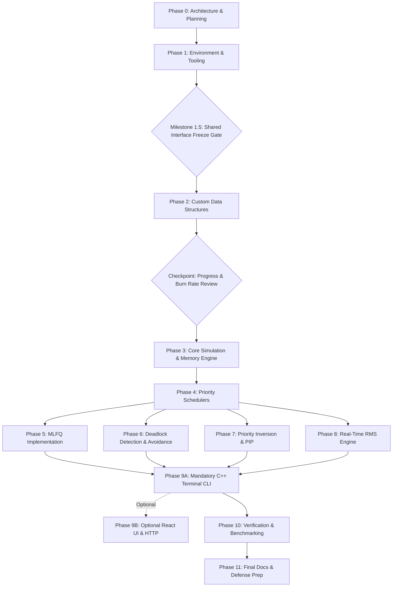

# Project Plan: OS-Level Task Priority Scheduler

**Document ID:** `DOC-PLAN-001`  
**Phase:** Phase 0 (Requirements Analysis and Implementation Planning)  
**Status:** READY FOR TEAM APPROVAL  
**Authors:**
- Minarv Tyagi (Enrollment: 2501200090)
- Akshat Verma (Enrollment: 2501200074)
- Keshav Kishor (Enrollment: 2501200087)  
**Institution:** Jaypee Institute of Information Technology (JIIT)  
**Supervisors:** Dr. Varun Srivastava, Dr. Kirti Jain  
**Repository:** [OS-Level-Task-Priority-Scheduler](https://github.com/akshatverma1707-ops/OS-Level-Task-Priority-Scheduler)

---

## 1. Executive Summary and Project Nature

The **OS-Level Task Priority Scheduler** is an educational, simulation-oriented software system developed in C++ to model, analyze, and benchmark operating-system CPU scheduling, simulated memory allocation admission, process synchronization, priority inversion management, deadlock detection, and deadlock avoidance.

> [!IMPORTANT]
> **Educational Simulation Scope Disclaimer:**  
> This project is a deterministic algorithmic simulation. It does not replace or modify an operating-system kernel, does not execute privileged CPU instructions (Ring 0), does not interact directly with hardware Memory Management Units (MMU), and does not preempt host OS threads via hardware interrupts. All process execution times, memory allocations, context switches, clock ticks, and I/O interrupts are modeled deterministically using virtual simulation time.

---

## 2. Requirements Categorization and Traceability Matrix

To maintain rigorous requirements traceability, all project requirements are strictly partitioned into four categories:

```
+-------------------------------------------------------------------------------+
|                        REQUIREMENTS CLASSIFICATION                            |
+-------------------------------------------------------------------------------+
| [CAT-A] Baseline Synopsis Requirements (Found in JIIT Project Synopsis)       |
| [CAT-B] Additional Explicit Prompt Requirements (OS & Algorithm Expansions)   |
| [CAT-C] Architectural and Engineering Recommendations (Systems Best Practice) |
| [CAT-D] Unresolved Decisions Requiring Explicit Team Approval                 |
+-------------------------------------------------------------------------------+
```

### 2.1. Category A: Baseline Synopsis Requirements
These requirements are established in the official *DS Project Synopsis* submitted to JIIT:
1. **[REQ-A01] C++ Core Logic:** All process management, scheduling logic, and simulation loops must be implemented natively in C++.
2. **[REQ-A02] Custom Data Structures:** Standard Template Library (STL) containers are bypassed for core scheduling and registry structures in favor of custom-built node-based structures.
3. **[REQ-A03] Process Generator & Process Control Block (PCB):** Processes must possess a unique Process ID (`PID`), priority level, memory footprint/weight, and basic execution attributes.
4. **[REQ-A04] Simulated Memory Capacity & FIFO Admission Control:**
   - The simulator models a configurable total system physical RAM capacity (e.g., 1024 MB).
   - Tasks specify a required memory footprint upon submission.
   - Tasks are admitted to `READY` only if `current_used_memory + task.memory_mb <= total_capacity`.
   - If memory is insufficient, tasks enter a custom `CustomFIFOQueue` admission wait-queue (`WAITING_FOR_MEMORY`).
   - **Documented Architectural Limitation:** Strict FIFO admission introduces **Head-of-Line (HoL) Blocking** (a large task at the queue head needing 512 MB blocks subsequent 64 MB tasks even when 256 MB is free). This limitation is retained by design to preserve strict arrival ordering.
5. **[REQ-A05] AVL Tree Process Registry:** An AVL Tree to maintain active processes indexed by `PID`, providing guaranteed $O(\log n)$ search, insertion, and deletion.
6. **[REQ-A06] Priority Execution Queue (Heap):** A binary heap to serve as the ready queue, ensuring the highest-priority task is always accessible at the root ($O(1)$ peek) for CPU dispatching, with PCB-to-heap index tracking for $O(\log n)$ priority updates.
7. **[REQ-A07] Hash Table Process History:** A hash table caching terminated and suspended processes to allow $O(1)$ expected retrieval of historical status and execution summaries.
8. **[REQ-A08] K-ary Process Tree:** A tree structure mapping parent-child relationships among spawned processes and background threads, accurately representing task hierarchies.
9. **[REQ-A09] Process Lifecycle Operations:** Capabilities to dynamically submit tasks, execute tasks, suspend tasks, and forcibly kill running or queued tasks.
10. **[REQ-A10] Terminal Interface Baseline:** A mandatory terminal-based user console for task submission, interactive execution, ASCII Gantt charts, and operational inspection.
11. **[REQ-A11] Algorithmic Metrics:** Tracking waiting times, turnaround times, and demonstrating improved system performance over basic FIFO scheduling.

### 2.2. Category B: Additional Explicit Requirements
These requirements extend the baseline synopsis into a comprehensive systems engineering demonstration:
1. **[REQ-B01] Dual Priority Scheduling Modes:** Implementation of both **Non-Preemptive Priority Scheduling** and **Preemptive Priority Scheduling**.
2. **[REQ-B02] Context Switch Accounting:** Discrete tracking and penalization of CPU context-switch latency during process preemption and voluntary yield.
3. **[REQ-B03] Deterministic Tie-Breaking:** Explicit, reproducible tie-breaking rules for processes with identical priority (ordered by earlier arrival time, then secondary PID).
4. **[REQ-B04] Starvation Detection & Reporting:** Real-time monitoring of task waiting durations against a starvation threshold with telemetry alerts.
5. **[REQ-B05] Deadlock Detection Module (Two Distinct Algorithms):**
   - **Algorithm 1 (`SingleUnitRAGDetector`):** Cycle detection via 3-color DFS graph traversal ($O(V+E)$) on single-instance resource graphs, where a directed cycle is necessary and sufficient for deadlock.
   - **Algorithm 2 (`VectorReductionDetector`):** Vector Reduction Algorithm (Shoshani-Coffman) for multiple-instance resources, maintaining `Available`, `Allocation`, and `Request` matrices ($O(m \times n^2)$), explicitly recognizing that cycles are necessary but not sufficient in multi-unit models.
6. **[REQ-B06] Deadlock Avoidance Module (Banker's Algorithm):**
   - **Algorithm 3 (`BankerAvoidance`):** Dijkstra's Banker's Algorithm supporting safe-state verification, request validation, and safe-sequence generation. Operates proactively to prevent entering unsafe states, complementing reactive detection.
7. **[REQ-B07] Priority Inversion & Priority Inheritance Protocol (PIP):**
   - **Mandatory Baseline Scope:**
     * Support for multiple independent mutexes across the system.
     * Support for multiple waiting processes queued on each mutex.
     * Support for multiple locks held simultaneously by a single process ($HeldLocks$).
     * Dynamic elevation of lock holder's effective priority to match the highest waiting task.
     * Effective-priority recalculation upon lock release across all remaining held locks:
       $$\text{EffectivePriority}(P_i) = \min \left( \text{BasePriority}(P_i), \min_{M_r \in HeldLocks(P_i) \setminus \{M_a\}} \left( \min_{P_w \in Waiters(M_r)} P_w.\text{effective\_priority} \right) \right)$$
   - **Explicit Deferral:** Nested/transitive priority inheritance chains ($P_1 \to M_1 \to P_2 \to M_2 \to P_3$) are explicitly deferred to an optional extension track to avoid mutex cycle deadlocks during baseline lab evaluation.
8. **[REQ-B08] Rate Monotonic Scheduling (RMS):**
   - **Assumptions of Liu & Layland Model:**
     1. All tasks are strictly periodic with constant period $T_i$.
     2. Relative deadline equals period ($D_i = T_i$).
     3. Tasks are completely independent (no mutexes, no resource contention, no precedence constraints).
     4. Execution times are constant/worst-case ($C_i \le T_i$).
     5. Context switch times and scheduler overheads are negligible ($\approx 0$).
     6. Tasks are preemptible at any discrete tick.
     7. Static priority is assigned according to rate-monotonic order: shorter period yields higher scheduling priority ($T_i < T_j \implies \text{Priority}_i < \text{Priority}_j$ under our custom priority convention where smaller numerical value means higher scheduling priority).
   - **Sufficiency vs. Feasibility Bounds:**
     * $U \le n(2^{1/n} - 1)$ is a **sufficient condition**, but **NOT a necessary condition**. Harmonic task sets with $U > U_{bound}$ up to $1.0$ are completely schedulable without misses.
     * $U \le 1.0$ is the **necessary feasibility condition** for any single-processor schedule. If $U > 1.0$, the task set is definitely unschedulable.
   - **Discrete Execution Simulation & Hyperperiod Overflow Protection:**
     * Simulates task releases, bursts, and deadlines over a configurable simulation horizon ($H_{sim}$) or hyperperiod ($\text{LCM}(T_1, \dots, T_n)$).
     * Guards against 64-bit integer overflow during $\text{LCM}$ calculation by computing $\text{GCD}$ first and capping at $H_{sim\_max}$ (e.g. 100,000 ticks).
     * **Deterministic Boundary Event Ordering:** At boundary tick $t = d$, if a task completes its final burst tick, the task completion evaluation occurs **before** deadline evaluation; hence, completion exactly at $t=d$ is recorded as **MET / SUCCESSFUL**, not a deadline miss. If remaining burst $>0$ at $t=d$, an explicit **`DEADLINE_MISS` event** is logged.
9. **[REQ-B09] Multilevel Feedback Queue (MLFQ):**
   - Minimum 3 distinct priority queues with decreasing priority and increasing time quanta.
   - Strict demotion rules for processes consuming their full time quantum.
   - Retention of priority for processes that yield before quantum expiration (I/O burst simulation).
   - Starvation prevention via configurable periodic global priority boost.
10. **[REQ-B10] Comprehensive Analytics Module:** Unified reporting of:
    - Average and per-process Waiting Time ($W$).
    - Average and per-process Turnaround Time ($TAT$).
    - Average and per-process Response Time ($RT$).
    - CPU Utilization percentage ($U_{cpu}$).
    - System Throughput (processes completed per unit time).
    - Total context switches.
    - Deadline misses count (for RMS).
    - Starvation metrics.

### 2.3. Category C: Architecture & Systems Recommendations
1. **[REC-C01] Binary Heap over Fibonacci Heap:** Implement a custom dynamic array-backed binary heap with an auxiliary index map (`pcb->heap_index`).
2. **[REC-C02] Left-Child Right-Sibling (LCRS) K-ary Tree:** Represent the K-ary process hierarchy using binary tree node mechanics (`first_child`, `next_sibling`).
3. **[REC-C03] Hybrid Tick-Event Simulation Clock:** Single-tick stepping ($\Delta t = 1$) during CPU bursts and context switches; event jumps when CPU is completely idle.
4. **[REC-C04] Separate Chaining with Prime Modulo for History Hash Table:** Custom singly-linked buckets and Knuth's multiplicative hash with dynamic doubling at $\alpha > 0.75$.
5. **[REC-C05] Abstract `IScheduler` Interface:** Decouple engine core from policies (Preemptive, Non-Preemptive, MLFQ, RMS).
6. **[REC-C06] Dual-Mode Interface Architecture:** Mandatory C++ Terminal CLI dashboard as default; optional React + TypeScript web UI served via embedded C++ HTTP server, conditional on explicit team approval.

### 2.4. Category D: Unresolved Decisions Requiring Explicit Team Approval
1. **[DEC-01] Frontend Selection:** Terminal CLI is mandatory; embedded HTTP server and React UI remain optional pending explicit team vote.
2. **[DEC-02] Scope of STL Exemption:** Prohibit STL containers in custom data structure layer; permit standard strings and file streams for workload parsing and console formatting.
3. **[DEC-03] Priority Convention:** Standardize custom priority convention where 0 = highest priority, 99 = lowest priority, and smaller numerical value means higher scheduling priority.
4. **[DEC-04] Banker's Algorithm Integration Scope:** Dedicated modular engine complementing RAG detection.
5. **[DEC-09] Simulated Memory Model:** Total RAM capacity with FIFO admission queue and documented Head-of-Line blocking.

---

## 3. Scope Boundaries and Non-Goals

```
+---------------------------------------------------+---------------------------------------------------+
|                  IN SCOPE                         |                   OUT OF SCOPE                    |
+---------------------------------------------------+---------------------------------------------------+
| Algorithmic simulation of CPU scheduling          | Native OS kernel modules or drivers (Ring 0)      |
| Custom node-based data structures in C++          | Preemption of real host OS operating threads      |
| Deterministic discrete virtual clock              | Hardware interrupt handling or ACPI timers        |
| Synthetic workload generation & JSON replay       | Physical MMU / Paging / Virtual Memory paging     |
| Simulated system RAM & FIFO admission queue       | Production multi-threaded kernel locks (pthreads) |
| Mandatory C++ ANSI Terminal CLI dashboard         | Mandatory web server / mandatory React frontend   |
| Exact mathematical metrics calculation            | Cloud deployment, Docker swarms, external DBs     |
| Single-unit RAG cycle DFS & multi-unit reduction  | Distributed consensus or network scheduling       |
| Dijkstra's Banker's algorithm safe sequence       | Transitive priority inheritance across deep locks |
| Multi-mutex holding & release recalculation       | Speculative out-of-order memory admission         |
+---------------------------------------------------+---------------------------------------------------+
```

---

## 4. Phased Implementation Roadmap (Phases 0 through 11)



---

### Phase 0: Requirements Analysis, Architecture & Planning
- **Status:** **READY FOR TEAM APPROVAL**
- **Objective:** Establish an exhaustive, team-reviewed technical specification, architectural blueprint, data structure design, interface contract, test strategy, and decision register before any code is written.
- **Estimated Effort:** 18 engineer-hours (preliminary planning target; 6h per member).
- **Exit Gate:** Explicit written approval of Phase 0 artifacts by all three team members (Minarv Tyagi, Akshat Verma, Keshav Kishor).
- **Git History Invariant:** No new commits or pushes were performed during the Phase 0 revision. The existing Git repository, remote configuration, and initial commit remain unchanged.

---

### Phase 1: Repository, Toolchain, and Development Environment Setup
- **Objective:** Configure a reproducible C++ build system, compiler flags, testing harness, and code-quality tooling.
- **Estimated Effort:** 12 engineer-hours (preliminary target; 4h per member).
- **Exit Gate:** Clean build and successful test suite run on every team member's machine.

---

### Milestone 1.5: Shared Interfaces Formal Sign-Off Gate (MANDATORY GATE)
- **Objective:** Establish, review, and freeze the central shared interfaces before individual members begin implementing dependent modules.
- **Headers to Freeze:** `Types.hpp`, `Process.hpp`, `IScheduler.hpp`, `ResourceTypes.hpp`, `SimulationClock.hpp`, `MemoryManager.hpp`.
- **Exit Gate:** Unanimous sign-off by Minarv Tyagi, Akshat Verma, and Keshav Kishor.

---

### Phase 2: Process Model and Custom Data Structures
- **Objective:** Implement and thoroughly test all custom node-based data structures without STL containers for core storage.
- **Estimated Effort:** 42 engineer-hours (preliminary target; 14h per member).
- **Exit Gate:** All custom data structures pass independent unit tests with clean AddressSanitizer runs.

---

### Checkpoint: First Implementation Milestone Progress & Burn Rate Review
- **Objective:** Team review meeting upon completion of Phase 2.
- **Review Items:** Compare actual hours spent on Phase 1 & Phase 2 against preliminary estimates; assess compiler compatibility, code-review turnaround, and memory safety tooling; recalibrate hour budgets for remaining phases if needed.

---

### Phase 3: Core Simulation Engine, Clock & Memory Admission
- **Objective:** Construct the deterministic simulation engine, virtual clock, CPU execution dispatcher, state transition coordinator, and simulated memory capacity admission controller with Head-of-Line blocking reporting.
- **Estimated Effort:** 24 engineer-hours (preliminary target; 8h per member).
- **Exit Gate:** Simulation engine passes baseline workload test with verified time and memory logs.

---

### Phase 4: Priority Scheduling and Preemptive Multitasking
- **Objective:** Implement both Non-Preemptive and Preemptive Priority Schedulers using custom binary heap with deterministic tie-breaking and starvation telemetry.
- **Estimated Effort:** 21 engineer-hours (preliminary target; 7h per member).
- **Exit Gate:** Both schedulers match analytical reference test cases 100%.

---

### Phase 5: Multilevel Feedback Queue (MLFQ)
- **Objective:** Design and implement MLFQ scheduling with multiple priority tiers, time quanta, dynamic demotions, voluntary I/O yield preservation, and periodic priority boosting.
- **Estimated Effort:** 21 engineer-hours (preliminary target; 7h per member).
- **Exit Gate:** MLFQ unit test suite passes with all queue-transition rules verified.

---

### Phase 6: Deadlock Management (Three Distinct Algorithms)
- **Objective:** Implement three isolated, independently testable deadlock algorithms:
  1. `IRAGCycleDetector` (3-color DFS cycle detection for single-instance resources).
  2. `IMultiUnitDeadlockDetector` (Vector Reduction Algorithm / Shoshani-Coffman for multi-instance resources).
  3. `IBankerAvoidance` (Dijkstra's Banker's Algorithm for proactive avoidance and safe-sequence generation).
- **Estimated Effort:** 24 engineer-hours (preliminary target; 8h per member).
- **Exit Gate:** All three algorithms pass independent verification test suites.

---

### Phase 7: Priority Inversion and Priority Inheritance Protocol (PIP)
- **Objective:** Implement mandatory baseline PIP supporting multiple independent mutexes, multiple waiting processes, multiple held locks per process, and effective priority recalculation across remaining locks upon release. (Nested/transitive chains deferred to extension).
- **Estimated Effort:** 21 engineer-hours (preliminary target; 7h per member).
- **Exit Gate:** PIP test suite cleanly proves Mars Pathfinder inversion mitigation and multi-lock priority recalculation.

---

### Phase 8: Real-Time Rate Monotonic Scheduling (RMS)
- **Objective:** Implement real-time periodic task scheduling governed by Rate Monotonic priority assignment with utilization checking, configurable simulation horizon ($H_{sim}$), hyperperiod overflow handling, discrete simulation, and deadline-miss detection.
- **Estimated Effort:** 18 engineer-hours (preliminary target; 6h per member).
- **Exit Gate:** RMS test suite passes all bound sufficiency, harmonic schedulability, and deadline-miss assertions.

---

### Phase 9A: Mandatory C++ Terminal Interface & Analytics Dashboard
- **Objective:** Construct mandatory native C++ ANSI Terminal CLI dashboard providing interactive command prompt, tabular metrics reporting, and ASCII execution Gantt charts.
- **Estimated Effort:** 18 engineer-hours (preliminary target; 6h per member).
- **Exit Gate:** Standalone terminal executable runs all demonstration workloads cleanly.

---

### Phase 9B: Optional React Web UI & Embedded HTTP Server (CONDITIONAL TRACK)
- **Objective:** If and only if explicitly approved by team, implement lightweight embedded C++ HTTP server (`cpp-httplib`) and React web UI.
- **Status:** **OPTIONAL EXTENSION — PENDING TEAM APPROVAL (ADR-01)**.
- **Estimated Effort:** +30 optional engineer-hours.

---

### Phase 10: Comprehensive Verification, Benchmarking, and Robustness
- **Objective:** End-to-end regression testing, AddressSanitizer memory audits, edge-case validation, and performance benchmarking.
- **Estimated Effort:** 21 engineer-hours (preliminary target; 7h per member).
- **Exit Gate:** Full verification test pass with zero sanitizer defects.

---

### Phase 11: Final Documentation, Demonstration Workloads, and Defense Preparation
- **Objective:** Prepare comprehensive laboratory reports, user documentation, pre-packaged demonstration workloads, and slide decks for academic defense.
- **Estimated Effort:** 15 engineer-hours (preliminary target; 5h per member).
- **Exit Gate:** Successful team rehearsal of live demonstration and final sign-off.

---

## 5. Summary of Phased Roadmap Effort Distribution

| Phase | Description | Preliminary Effort Target | Primary Responsibility |
|:-----:|:------------|:-------------------------:|:----------------------:|
| **0** | Requirements Analysis & Planning | 18 hours | All Members (6h each) |
| **1** | Repository & Toolchain Setup | 12 hours | Lead Architect (4h each) |
| **M1.5** | Shared Interface Formal Sign-Off Gate | *(Included in P1/P2)* | All Members (Mandatory Gate) |
| **2** | Process Model & Custom Data Structures | 42 hours | Data Structures Lead (14h each) |
| **CHK** | Progress & Burn Rate Checkpoint | *(Review meeting)* | All Members |
| **3** | Core Simulation Engine, Clock & Memory Admission | 24 hours | Engine Specialist (8h each) |
| **4** | Priority Scheduling & Preemption | 21 hours | Algorithms Lead (7h each) |
| **5** | Multilevel Feedback Queue (MLFQ) | 21 hours | Algorithms Lead (7h each) |
| **6** | Deadlock Modules (3 Distinct Algorithms) | 24 hours | Resource & Sync Lead (8h each) |
| **7** | Priority Inversion & Multi-Lock PIP | 21 hours | Algorithms & Sync Lead (7h each) |
| **8** | Real-Time Rate Monotonic Scheduling (RMS) | 18 hours | Algorithms Lead (6h each) |
| **9A**| Mandatory C++ ANSI Terminal CLI Dashboard | 18 hours | Interface & Analytics Lead (6h each) |
| **10**| Comprehensive Verification & Benchmarks | 21 hours | All Members (7h each) |
| **11**| Final Documentation & Defense Rehearsal | 15 hours | All Members (5h each) |
| **CORE**| **Total Preliminary Planning Target** | **255 hours** | **85 hours / member (~6h / week)** |
| *9B* | *Optional React Web UI & Embedded HTTP Server* | *+30 hours* | *Optional Extension (ADR-01)* |

> [!NOTE]
> **Planning Target Clarification:**  
> The 255-hour figure is a **preliminary planning target**, not a guaranteed commitment. The formal Checkpoint after Milestone 1.5 / Phase 2 will assess actual burn rate and recalibrate subsequent milestones based on empirical progress.
