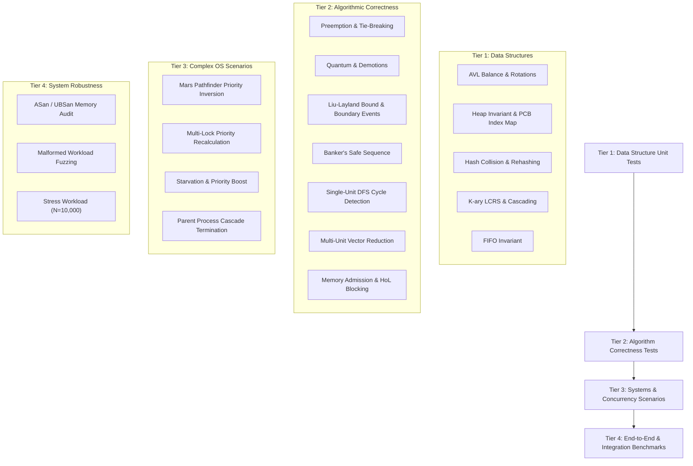

# Quality Assurance & Testing Strategy: OS-Level Task Priority Scheduler

**Document ID:** `DOC-TEST-001`  
**Phase:** Phase 0 (Requirements Analysis and Implementation Planning)  
**Status:** READY FOR TEAM APPROVAL  
**Authors:** Minarv Tyagi, Akshat Verma, Keshav Kishor  
**Institution:** Jaypee Institute of Information Technology (JIIT)  
**Supervisors:** Dr. Varun Srivastava, Dr. Kirti Jain  

---

## 1. Testing Philosophy and Simulation Advantage

Testing an operating system scheduler is traditionally plagued by nondeterminism, hardware clock drift, and asynchronous race conditions. 

In this project, our architecture leverages **Deterministic Discrete Virtual Time**:
- Given an identical workload input vector and simulation configuration, the simulator guarantees **100% bit-for-bit reproducible execution traces**.
- Time advances strictly in discrete integer ticks ($\Delta t = 1$) or discrete event jumps.
- Scheduling decisions, preemption events, lock contentions, memory admissions, and context switches can be verified against exact analytical proofs.

> [!NOTE]
> **No Fabricated Test Results:**  
> Because Phase 0 is strictly a requirements and planning phase, no code or test suites have been executed. The test cases documented below define the formal test specifications, input vectors, preconditions, invariants, and mathematical assertions that must be implemented and satisfied in Phase 10.

---

## 2. Test Architecture and Categorization

The test harness is organized into four rigorous testing tiers:

---

## 3. Tier 1: Custom Data Structure Test Specifications

### 3.1. AVL Tree Registry Test Suite (`test_avl_tree.cpp`)
- **Test 1.1: Single Rotations (LL and RR):**
  - *Input:* Insert sequential ascending PIDs $\{1, 2, 3\}$ (RR heavy) and descending PIDs $\{3, 2, 1\}$ (LL heavy).
  - *Expected Invariant:* Root becomes $2$; left child $1$, right child $3$; height equals $2$; $BF \in \{-1, 0, 1\}$ at every node.
- **Test 1.2: Double Rotations (LR and RL):**
  - *Input:* Insert PIDs $\{3, 1, 2\}$ (LR heavy) and $\{1, 3, 2\}$ (RL heavy).
  - *Expected Invariant:* Root becomes $2$; balanced binary search tree invariant holds.
- **Test 1.3: Deletion of Internal Nodes:**
  - *Input:* Populate tree with 15 nodes; delete a leaf node; delete a node with 1 child; delete a node with 2 children.
  - *Expected Invariant:* Tree rebalances correctly after each deletion; in-order traversal yields strictly sorted PIDs.
- **Test 1.4: Asymptotic Height Stress Test:**
  - *Input:* Insert 10,000 randomized unique PIDs.
  - *Expected Invariant:* Measured tree height $H \le 1.44 \log_2(10000 + 2) \approx 19$. No height violation permitted.

### 3.2. Binary Min-Heap Priority Queue Test Suite (`test_binary_heap.cpp`)
- **Test 2.1: Min-Heap Property Invariant:**
  - *Input:* Insert 500 processes with random priority values $[1, 100]$.
  - *Expected Invariant:* For every index $i > 0$, $\text{Priority}(\text{parent}(i)) \le \text{Priority}(i)$.
- **Test 2.2: Deterministic Tie-Breaking:**
  - *Input:* Insert $P_A$ (Priority 5, Arrival 10, PID 101), $P_B$ (Priority 5, Arrival 5, PID 102), $P_C$ (Priority 5, Arrival 5, PID 99).
  - *Expected Extraction Order:* $P_C$ first (same priority, earlier arrival, lowest PID), then $P_B$, then $P_A$.
- **Test 2.3: PCB-to-Heap Index Synchronization (`heap_index`):**
  - *Input:* Insert 20 processes; verify that for every index $k \in [0, \text{size}-1]$, `heapArray[k]->heap_index == k`.
  - Extract 10 processes; verify that `heap_index` remains strictly synchronized for all remaining elements and set to `INDEX_NONE` for extracted elements.
- **Test 2.4: In-Place Priority Update (`updateEffectivePriority`):**
  - *Input:* Insert 10 processes; locate $P_5$ (currently at index 7 with priority 50); call `updateEffectivePriority(P_5, 2)`.
  - *Expected Invariant:* $P_5$ percolates up via `siftUp(7)` to index 0 in $O(\log n)$; `peek()` immediately returns $P_5$.
  - Lower priority to 90; call `updateEffectivePriority(P_5, 90)`. $P_5$ percolates down via `siftDown(0)` to correct bottom position.

### 3.3. Hash Table History Test Suite (`test_hash_table.cpp`)
- **Test 3.1: Collision Chain Integrity:**
  - *Input:* Craft 10 distinct PIDs engineered to hash to the exact same bucket modulo.
  - *Expected Invariant:* All 10 records are retrievable; singly-linked bucket list contains all nodes without memory corruption.
- **Test 3.2: Dynamic Rehashing under Load:**
  - *Input:* Initial table size 17; insert 13 records (load factor $13/17 \approx 0.76 > 0.75$).
  - *Expected Invariant:* Table size dynamically doubles to next prime (37); all records remain retrievable.

### 3.4. K-ary Tree Hierarchy Test Suite (`test_kary_tree.cpp`)
- **Test 4.1: Arbitrary Branching Factor:**
  - *Input:* Parent process PID 1 spawns 20 child processes.
  - *Expected Invariant:* LCRS structure maintains `first_child` pointing to child 1; siblings linked sequentially via `next_sibling`.
- **Test 4.2: Cascading Subtree Termination:**
  - *Input:* Hierarchy: $P_1 \to P_2 \to \{P_3, P_4\}$. Call `cascadingKill(2)`.
  - *Expected Invariant:* $P_2, P_3, P_4$ are terminated and removed; $P_1$ remains active with its child pointer updated to `nullptr`.

---

## 4. Tier 2: Algorithm Correctness Test Specifications

### 4.1. Preemptive Priority Scheduling Verification
- **Scenario:**
  - $P_1$: Arrival $t=0$, Burst $8$, Priority $3$
  - $P_2$: Arrival $t=2$, Burst $4$, Priority $1$ (higher urgency)
  - $P_3$: Arrival $t=4$, Burst $2$, Priority $2$
  - Context switch penalty: $1$ tick.
- **Expected Execution Trace:**
  - $t=0 \dots 2$: $P_1$ runs (Remaining burst: 6).
  - $t=2$: $P_2$ arrives (Priority 1 < 3). Preemption triggered! Context switch overhead $t=2 \dots 3$.
  - $t=3 \dots 7$: $P_2$ runs to completion.
  - $t=7 \dots 8$: Context switch overhead to $P_3$ (Priority 2).
  - $t=8 \dots 10$: $P_3$ runs to completion.
  - $t=10 \dots 11$: Context switch overhead to $P_1$.
  - $t=11 \dots 17$: $P_1$ completes remaining 6 burst ticks.
- **Mathematical Invariant Assertions:**
  - Completion Times: $P_2 = 7$, $P_3 = 10$, $P_1 = 17$.
  - Turnaround Time: $TAT(P_i) = \text{Completion}_i - \text{Arrival}_i$.
  - Waiting Time: $W(P_i) = TAT_i - \text{Burst}_i - \text{CS\_Penalty}$.

### 4.2. Simulated Memory Allocation, Exhaustion, Reclamation & HoL Blocking
- **Test 4.2A: Allocation and Exhaustion:**
  - System Capacity = 1024 MB.
  - $P_1$ (512 MB) and $P_2$ (512 MB) arrive at $t=0$. Both admitted (`Used = 1024 MB`, `Free = 0 MB`).
  - $P_3$ (256 MB) arrives at $t=1$.
  - *Assertion:* $P_3$ cannot be admitted; transitions to `WAITING_FOR_MEMORY` and enters `CustomFIFOQueue`. AVL registry does NOT contain $P_3$.
- **Test 4.2B: Process Termination & Memory Reclamation:**
  - $P_1$ terminates at $t=10$.
  - *Assertion:* 512 MB is reclaimed. `Used = 512 MB`, `Free = 512 MB`.
  - `ProcessManager` evaluates admission queue: $P_3$ requests 256 MB $\le 512$ MB free.
  - $P_3$ dequeued, allocated 256 MB (`Used = 768 MB`), and admitted to `READY` (inserted into AVL registry and ready heap).
- **Test 4.2C: Head-of-Line (HoL) Blocking Demonstration:**
  - System Capacity = 1024 MB. Currently Used = 768 MB (Free = 256 MB).
  - Queue Head: $P_{head}$ requests 512 MB.
  - Next in Queue: $P_{small}$ requests 64 MB.
  - *Assertion:* Despite 256 MB being free, $P_{small}$ is **blocked behind $P_{head}$** due to strict FIFO queue ordering. Verifies documented HoL architectural limitation.

### 4.3. Deadlock Module: Three Independently Testable Algorithms

#### Algorithm 1: `SingleUnitRAGDetector` Test Suite (`test_rag_cycle.cpp`)
- **Scenario:** Single-instance resources $R_1, R_2$.
- Edge setup: $P_1 \to R_2$, $R_2 \to P_2$, $P_2 \to R_1$, $R_1 \to P_1$.
- *Assertion:* `SingleUnitRAGDetector::detectDeadlock()` returns `true`, identifying cycle nodes $\{P_1, R_2, P_2, R_1\}$.
- Acyclic graph with shared resource returns `false`.

#### Algorithm 2: `VectorReductionDetector` Test Suite (`test_multi_deadlock.cpp`)
- **Scenario:** Multiple-instance resources $R_1 (2 \text{ units}), R_2 (2 \text{ units})$.
  - $P_1$ holds 1 of $R_1$, requests 1 of $R_2$.
  - $P_2$ holds 1 of $R_2$, requests 1 of $R_1$.
  - $P_3$ holds 1 of $R_1$, requests nothing (completes and releases).
- Directed cycle exists in graph ($P_1 \to R_2 \to P_2 \to R_1 \to P_1$).
- *Assertion:* `VectorReductionDetector::detectDeadlock()` returns `false` (no deadlock, because $P_3$ unblocks the system). Proves cycle is not sufficient for multi-instance deadlock!

#### Algorithm 3: `BankerAvoidance` Test Suite (`test_banker.cpp`)
- **Silberschatz Reference Benchmark:**
  - 5 Processes ($P_0 \dots P_4$), 3 Resources ($A=10, B=5, C=7$).
  - Allocation: $P_0=[0,1,0], P_1=[2,0,0], P_2=[3,0,2], P_3=[2,1,1], P_4=[0,0,2]$.
  - Max: $P_0=[7,5,3], P_1=[3,2,2], P_2=[9,0,2], P_3=[2,2,2], P_4=[4,3,3]$.
  - Available: $[3, 3, 2]$.
- *Assertions:*
  - `isSafeState()` returns `true` with valid sequence $\langle P_1, P_3, P_4, P_0, P_2 \rangle$.
  - Request $P_1$ requests $[1, 0, 2]$ $\implies$ `evaluateRequest()` returns `true` (Granted).
  - Request $P_0$ requests $[0, 2, 0]$ $\implies$ `evaluateRequest()` returns `false` (Denied, leads to unsafe state).

---

## 5. Tier 3: Complex Systems Scenarios

### 5.1. Mars Pathfinder Priority Inversion & PIP Baseline
- **Scenario:** Low-priority task $T_L$ (Priority 3) holds Mutex $M_1$. High-priority task $T_H$ (Priority 1) arrives and blocks on $M_1$. Medium-priority task $T_M$ (Priority 2) arrives.
- **Without PIP:** $T_M$ preempts $T_L$; $T_H$ is starved. $T_M$ finishes before $T_H$.
- **With PIP:** $T_L$'s effective priority elevates to 1. $T_M$ cannot preempt $T_L$. $T_L$ releases $M_1$, restoring priority to 3. $T_H$ executes and finishes before $T_M$.

### 5.2. Multi-Lock Priority Recalculation on Lock Release
- **Scenario:** Task $P_A$ (Base Priority 4) holds Mutex $M_1$ and Mutex $M_2$.
  - Task $P_B$ (Priority 1) waits on $M_1$.
  - Task $P_C$ (Priority 2) waits on $M_2$.
  - $P_A$'s effective priority is $\min(4, 1, 2) = 1$.
  - $P_A$ releases $M_1$.
- **Assertion:** $P_A$ does not drop to base priority 4! It still holds $M_2$ (waiter $P_C$ has priority 2). Its effective priority recalculates to $\min(4, 2) = 2$.
- When $P_A$ releases $M_2$, its effective priority cleanly restores to base priority 4.

### 5.3. Rate Monotonic Scheduling (RMS): Assumptions, Horizon & Boundary Events
- **Test 5.3A: Harmonic Task Set Exceeding Liu-Layland Bound ($U = 1.0 > U_{bound}$):**
  - $\tau_1: C_1=5, T_1=10 \implies U_1 = 0.5$.
  - $\tau_2: C_2=10, T_2=20 \implies U_2 = 0.5$.
  - Total $U = 1.0 > 0.828$. Bound is inconclusive.
  - Simulation over hyperperiod $\text{LCM}(10, 20) = 20$ ticks demonstrates **0 deadline misses**. (Proves sufficiency, not necessity).
- **Test 5.3B: Overloaded Task Set ($U > 1.0$):**
  - $\tau_1: C_1=6, T_1=10$, $\tau_2: C_2=6, T_2=10 \implies U = 1.2 > 1.0$.
  - Simulation over hyperperiod logs explicit `DEADLINE_MISS` event for $\tau_2$ at $t=10$.
- **Test 5.3C: Boundary Event Ordering at $t = d$:**
  - Task $\tau_k$ has period $T = 10$, execution time $C = 4$.
  - Released at $t = 0$, absolute deadline $d = 10$.
  - Task receives CPU ticks at $t=6, 7, 8, 9$. At tick $t = 10$, remaining burst reaches 0 exactly when $t = d$.
  - *Assertion:* Completion evaluation executes **before** deadline-miss check. Task is recorded as **`MET / SUCCESSFUL`**, NOT a deadline miss!
- **Test 5.3D: Simulation Horizon & Hyperperiod Overflow Safety:**
  - Tasks with large coprime periods (e.g. $T_1=997, T_2=991$). Full $\text{LCM} \approx 988,027$ ticks.
  - Configurable simulation horizon $H_{sim} = 5,000$ ticks.
  - *Assertion:* Engine stops safely at $H_{sim}$ without integer overflow or infinite simulation execution.

---

## 6. Tier 4: System Robustness & Non-Functional Verification

### 6.1. Memory Leak and Safety Verification
- Compiling with AddressSanitizer (`-fsanitize=address`) and UndefinedBehaviorSanitizer (`-fsanitize=undefined`).
- **Assertion:** Zero memory leaks, zero heap-buffer-overflows, and zero use-after-free detections across 100 iterations of full simulation runs.

### 6.2. Input Fuzzing & Boundary Protection
The simulator must reject malformed inputs gracefully without crashing:
- Negative burst times ($B < 0$) or zero burst times ($B = 0$).
- Process memory footprint exceeding total system capacity ($M > \text{TotalRAM}$).
- Cyclic parent-child relationships in process definitions ($P_1 \to P_2 \to P_1$).
- Requested resource instances exceeding total system capacity.
- Non-existent PIDs queried in API or CLI.

---

## 7. Test Execution and Pass/Fail Criteria Matrix

| Test Suite | File Location | Metric Verified | Minimum Pass Threshold |
|:---|:---|:---|:---:|
| **AVL Tree Unit** | `backend/tests/test_avl.cpp` | Height bound, rotation correctness | 100% Pass (0 defects) |
| **Heap Unit & Index Map** | `backend/tests/test_heap.cpp` | Heap invariant, PCB index synchronization | 100% Pass (0 defects) |
| **Memory Allocation & HoL** | `backend/tests/test_memory.cpp`| Admission, reclaim, HoL blocking | 100% Pass (0 defects) |
| **Hash Table Unit** | `backend/tests/test_hash.cpp` | Collision chain, dynamic rehash | 100% Pass (0 defects) |
| **K-ary Tree Unit** | `backend/tests/test_kary.cpp` | LCRS branching, cascade kill | 100% Pass (0 defects) |
| **Priority Preemption** | `backend/tests/test_priority.cpp`| Context switch, Gantt timeline | Exact match with proof |
| **MLFQ Transitions** | `backend/tests/test_mlfq.cpp` | Demotions, I/O yield, boost | Exact match with rules |
| **Single-Unit RAG DFS** | `backend/tests/test_rag_cycle.cpp`| 3-color DFS cycle detection | 100% accuracy |
| **Multi-Unit Vector Reduc**| `backend/tests/test_multi_deadlock.cpp`| Vector reduction algorithm | 100% accuracy |
| **Banker's Algorithm** | `backend/tests/test_banker.cpp` | Safe state, sequence generation | 100% match with benchmark |
| **Priority Inversion PIP** | `backend/tests/test_pip.cpp` | Mars Pathfinder & multi-lock release | Exact match with proof |
| **Rate Monotonic (RMS)** | `backend/tests/test_rms.cpp` | Sufficiency, $t=d$ event order, horizon | 100% accurate detection |
| **Memory Sanitizer** | `backend/tests/memcheck` | Memory leaks & undefined behavior | 0 bytes leaked |
